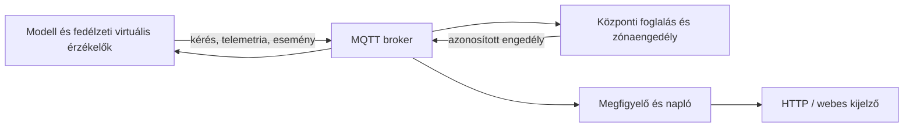

# Ipar 4.0 – gyári készjármű-parkolási szimulátor

## Fékezések gyorskeresése egy mentett útablakban

Az útelőzményben közvetlenül a megfigyelt fékezési szakaszokra, a legkisebb mozgás közbeni modellbeli tartalékra és a legerősebb alkalmazott lassulásra lehet ugrani. A gombok pontos fogadott keretet választanak ki, a térkép és az érzékelőnézet azt a rekordot mutatja. Az összegzés kizárólag a betöltött, legfeljebb 2000 mintás ablakra vonatkozik; az ismételt, hibás, ellentmondó és ismeretlen frissességű döntések külön számlálót kapnak. Az adatrések szétválasztják a szakaszokat.

[Műszaki leírás és definíciók](docs/DONTESABLAK_ES_FEKEZESKERESO.md). A 43 új ellenőrzés önállóan futtatható:

```powershell
node tests/frontend_decision_window.cjs
node tests/frontend_decision_navigator.cjs
```

A [friss fejlesztői nyugta](results/ui/decision-window-check.json) összesen 313 sikeres esetet és 2486 korábban fogadott MQTT-keret két külön ablakának offline vizsgálatát rögzíti. A [böngészős bizonyíték](results/ui/decision-window/browser-check.json) a tényleges ugrásokat, a natív mintaletöltést, az ablakváltás utáni törlést és a mobilos tördelést mutatja. A vezérlési összegzés nem igazol friss érzékelést vagy fizikai biztonságot. A mért mozgásmodell és konfigurációk változatlanok; a beadási jelentés forrásreferenciája továbbra is [f625cfe](https://github.com/JackYHUN/ipar4-gyari-parkolas/tree/f625cfe5e85cf5a8a28943704e7e025b89b7b0a4).

## Fékezési döntés élőben és az útelőzményben

Az érzékelőnézet új kártyája megmutatja a sebességet a vezérlési lépés előtt és után, az alkalmazott gyorsulást, a megállási célt és az ideális fékúthoz viszonyított modellbeli tartalékot. A fékezés és a már bekövetkezett megállás külön állapot. Elavult vagy hiányos adat külön jelzést kap; ellentmondó diagnosztikából nem számolunk tartalékot. A JSON- és SVG-mintaletöltés a nyers adatok mellett az értelmezést is megőrzi.

[Műszaki leírás és értelmezési határok](docs/FEKEZESI_DIAGNOSZTIKA.md). A változtatás a felületet bővíti, a mért mozgásmodell és konfigurációk eredeti SHA-256 értékei egyeznek. A 17 oldalas beadási jelentéshez tartozó korábbi kiadás [f625cfe](https://github.com/JackYHUN/ipar4-gyari-parkolas/tree/f625cfe5e85cf5a8a28943704e7e025b89b7b0a4) alatt érhető el.

Az új funkció 31 önálló ellenőrzése:

```powershell
node tests/frontend_braking_analysis.cjs
node tests/frontend_braking_panel.cjs
```

A korábbi [fejlesztői nyugta](results/ui/braking-panel-check.json) 239 korábbi regressziót és 2486 korábban fogadott vezérlési keret offline elemzését is rögzíti. A korábbi [böngészős vizsgálat](results/ui/braking/browser-check.json) külön igazolja az élő/archív megjelenítést, a tényleges mintaletöltéseket és a keskeny képernyős tördelést. Ez a felületi bővítés nem új statisztikai modellkampány.

Python-alapú oktatási prototípus, valódi helyi MQTT 3.1.1 adatúttal, webes megjelenítéssel, virtuális érzékelőkkel és ellenőrizhető parkolófoglalásokkal. A mozgásmodell mért forráspillanatképe: **v0.18.0**.

| Kurzuskonfiguráció | Érték |
|---|---:|
| Véges kohorsz / aktív felső korlát | 6 / 6 autó |
| Parkolóhely / kezdetben foglalt | 16 / 4 |
| Zebra / konfliktuszóna | 2 / 1 |
| Időlépés / érzékelési periódus | 0,05 / 0,1 s |
| Referencia / nagyobb érkezési terhelés | 9 / 3 s |



A központ az MQTT-n beérkezett parkolóérzékelést, kéréseket, telemetriát és eseményeket használja. A teljes modellállapot az ellenőrzést és a megjelenítést szolgálja. A jármű helyi fékezése virtuális észlelésből származik; a gyalogos kooperatív, a mozgás idealizált polilánc. A győri elrendezés bővítési konfigurációja nyilvános telephelyi források saját oktatási egyszerűsítése, nem valódi üzemi útvonal vagy kapacitásadat.

## Indítás

Az eredeti kampány CPython 3.12 alatt futott. A kódtár gyökerében:

```powershell
py -3.12 -m venv .venv
.\.venv\Scripts\python.exe -m pip install -r requirements-lock.txt
.\.venv\Scripts\python.exe -m factory_yard --config config/course-demo.json --seed 42 --strategy nearest
```

A kijelző a [helyi HTTP-címen](http://127.0.0.1:8765) nyílik meg; az alkalmazás saját helyi brokert indít. A kurzusdemó explicit konfigurációja fontos: a konfiguráció nélküli kijelző a nagyobb, győri bővítési térképet választhatja. A `--strategy fixed` kapcsoló a helyazonosító szerinti kiosztást indítja. A `.\inditas.ps1 --config config/course-demo.json` ugyanazt a futtatót használja.

## Friss páros modellmérés

Konfigurációnként 30 független futáspár, seed1001–1030; összesen 120 modellfutás és 720 autófutás. A közös exogén menetrend és zajkulcsok mellett az eltérő tényleges láthatóság és átkelési kezdet endogén. A 600 s felső határ előtt mind a hat autó beparkolásakor lezárható a számolás; ezt a teljes horizontú pilottal célmutatónként pontosan egyezőnek ellenőriztük. Egy seedhez tartozó teljes futáspár az újramintázási egység, 10000 bootstrap-újramintázással.

| Forgatókönyv | nearest − fixed idő (s/autó) | 95% bootstrap-intervallum | Úthossz (m/autó) |
|---|---:|---:|---:|
| Referencia, 9 s | −7,978 | [−8,533; −7,408] | −23,944 |
| Nagyobb terhelés, 3 s | −7,986 | [−8,542; −7,414] | −23,944 |

Mindkét eset úthosszintervalluma [−25,611; −22,222] m/autó. Az eredeti kampányban 0 befejezetlen autófutás és 0 referenciaellenőrzéssel észlelt ütközés volt; a 634 megfigyelt gyalogosérkezés létrejött, a párosítás és minden végrehajtott foglalási ellenőrzés megfelelt. A fő kampány 2026-10-12 07:22:37–07:29:39 UTC között, körülbelül **7 perc** alatt futott. Ez modellkísérlet determinisztikus memórián belüli protokollkézbesítéssel. A mérési runner explicit közös virtuális zajadaptere nem az MQTT-alkalmazás módosítása, és az időelőny nem hálózati vagy valós gyári teljesítményállítás.

Részletek: [eredmény](results/course-comparison-v18/RESULTS.md), [mérési terv](docs/VEGLEGES_MERESI_TERV.md), [összesítő és SHA-256 proveniencia](results/course-comparison-v18/summary.json), [páros CSV](results/course-comparison-v18/pairs.csv), [autóexport](results/course-comparison-v18/vehicle_results.csv).

## Újrafuttatás és a nyers adatok határa

A kódtár tömör bizonyítékot és a teljes horizontú seed1001 pilot négy eredeti nyers futását tartalmazza. A pilot és a korai lezárású pilot külön eredeti időbélyegű nyugtája megőrzött; a teljes horizontú baseline a jelenlegi modell és konfiguráció hash-eivel egyezik, az aktuális runner ehhez ellenőrzi a parkolási idő, úthossz és foglalás pontos azonosságát.

```powershell
.\.venv\Scripts\python.exe -m experiments.course_comparison --pilot
.\.venv\Scripts\python.exe -m experiments.course_comparison
.\.venv\Scripts\python.exe results/course-comparison-v18/validate_exports.py
```

Először a pilotot kell futtatni. A fő runner a pilot forrás- és konfigurációhash-eivel egyező állapotban engedi elindulni a 30-30 párt. Az új futás új helyi nyers adatokat és időbélyegű összesítőt készít; a számítás erőforrásfüggő, az eredeti gépen körülbelül 7 percet igényelt.

A **120 végleges futás teljes nyers esemény- és döntési naplója** a [data/course-comparison-v18.zip](data/course-comparison-v18.zip) tömörített mellékletben érhető el. Ez a teljes eredeti, körülbelül 97 MB-os nyers könyvtár; a ZIP körülbelül 3,6 MB. Az archívum felső könyvtára már `course-comparison-v18`, ezért a **`results/` gyökérbe** kell kibontani. A létrejövő adatok helye `results/course-comparison-v18/`.

```powershell
Expand-Archive -LiteralPath data/course-comparison-v18.zip -DestinationPath results -Force
.\.venv\Scripts\python.exe results/course-comparison-v18/validate_exports.py
```

A megőrzött [validation.json](results/course-comparison-v18/validation.json) a teljes eredeti helyi ellenőrzés nyugtája. A fenti parancs már a letöltött nyers fájlokat ellenőrzi újra; új időbélyegű helyi `validation.json` nyugtát ír. A tömör klón eredeti fájlazonosságát kibontás és újrafuttatás előtt a `tools/verify_public_evidence.py` vizsgálja. Új eredmények után a `--sources-only` mód használható a változatlan forrás ellenőrzésére.

```powershell
.\.venv\Scripts\python.exe tools/verify_public_evidence.py
.\.venv\Scripts\python.exe -m compileall -q factory_yard tests experiments
.\.venv\Scripts\python.exe -m unittest discover -s tests
```

A kódtár saját ellenőrző eszköze a tömör példány hash-eit, adatszámait és páros bootstrap-számítását ellenőrzi. Nem állít teljes nyersadat- vagy teljes MQTT-archívum-validálást hiányzó bemenetekből. Újragenerált eredményekhez a `--sources-only` mód a befagyasztott kód forrásazonosságát vizsgálja.

## Tényleges MQTT-ellenőrzés

A [kurzus MQTT-bizonyítékai](results/course-verification-v18/summary.json) külön három valódi helyi MQTT-futásból származnak: normál parkolás, megtelt parkoló, illetve idempotencia, zebra, érzékelőkiesés és kapcsolatmegszakítás. Az S02 közel egyidejű külön kéréseinek kizárása célzott koordinátorteszt, nem párhuzamos TCP-terhelésmérés. A tömör kódtár eredeti összesítőket, felvételi nyugtákat, hat esetbizonyítékot és jelölt eseményrészleteket őriz. A hivatkozott nagy felvétel- és futásexportok külön helyi beadási bizonyítékok; megőrzött hash-ük nem jelenti, hogy az archívum a klónban is jelen van.

Új helyi MQTT-kampány: `.\.venv\Scripts\python.exe -m experiments.course_verification`. A megfigyelő adatút, bizonyíték és értelmezési korlát leírása: [bemutató és bizonyíték](docs/BEADANDO_BEMUTATO_ES_BIZONYITEK.md). A modellmérés eredménye és a tényleges MQTT-bemutató külön bizonyítéktípus.

## Tartalom és források

`factory_yard/`: modell, központ, MQTT-adatút, napló és HTTP-szerver. `web/`: böngészős kijelző. `tests/`: célzott és regressziós ellenőrzések. `config/`: kurzus- és bővítési konfigurációk. `experiments/`: mérési és ellenőrző futtatók. `docs/course-report/`: saját UML-források és ábrák, bibliográfiai hivatkozások. A részletes állapot- és adatfolyamábra értelmezése az [ábramellékletben](docs/ABRA_MELLEKLET.md) található. A [SOURCE_MANIFEST.json](SOURCE_MANIFEST.json) a csomag fájlprovenienciáját rögzíti.

A személyes hallgatói kézirat, elérhetőség, régi kiadási csomag, virtuális környezet, cache és harmadik fél teljes PDF-anyaga nem része a kódtárnak. Az Audi-programfüzetet a [hivatkozásjegyzék](docs/course-report/references.json) eredeti forrásként hivatkozza; a saját oktatási ábrák nem valódi üzemrajzok. A csomag nem rendel kitalált licencet a szerző vagy a külső források munkájához; a függőségek és külső anyagok saját feltételei érvényesek.

## Ábrák újra-előállítása

A diagramok és statisztikai ábrák szerkesztőeszközei külön telepíthetők: `python -m pip install -r requirements-authoring.txt`. Ezután `python -m experiments.course_diagrams` és `python -m experiments.course_charts` futtatható. A videógenerátor külön a teljes helyi MQTT-felvételeket igényli; Windows Arial betűkészletet használ. A szimulátor futtatásához e kiegészítő csomagok nem szükségesek.

## Közzétételi történet

Ez egy már elkészült, ellenőrzött forráspillanatkép. A 2026. október 12-i négy commit a közzététel logikus részeit jelöli, tényleges feltöltési dátummal. A munka korábbi mérési és verifikációs dátumait az eredeti naplónyugták őrzik; a publikálási commitokból fejlesztési időtartam nem következik.
