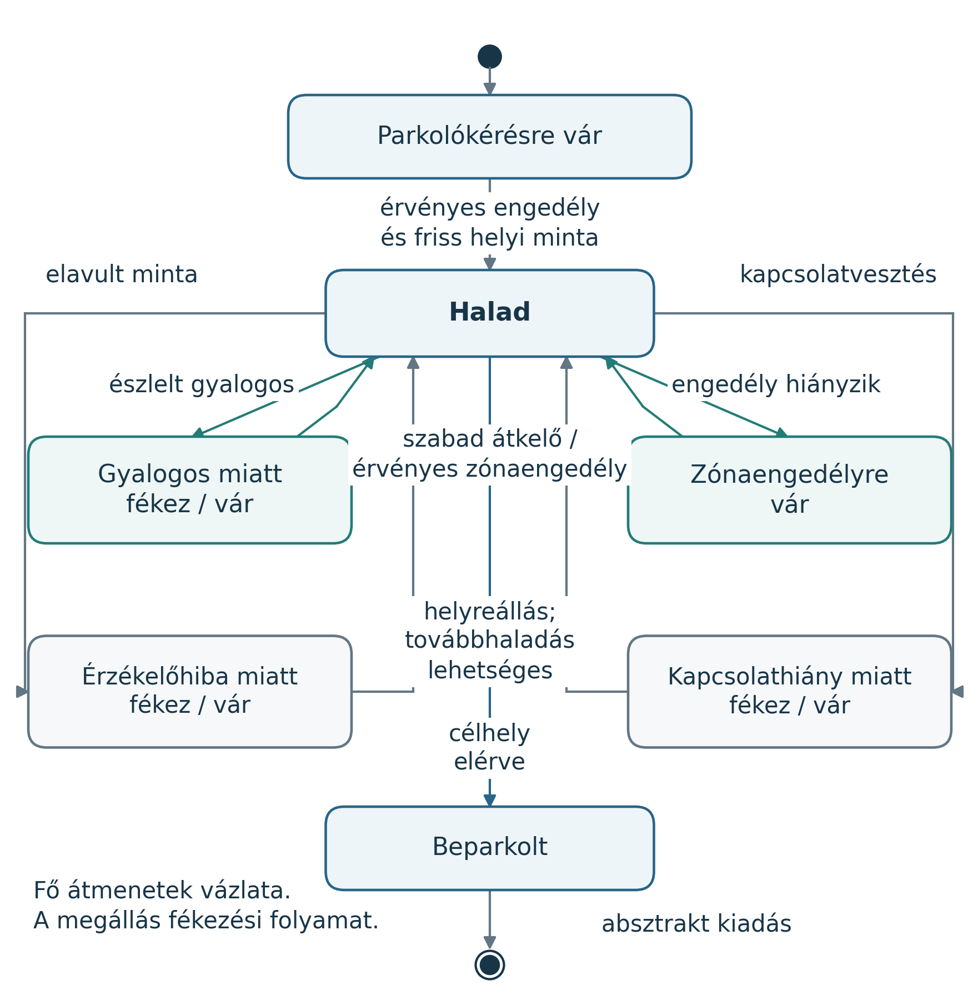
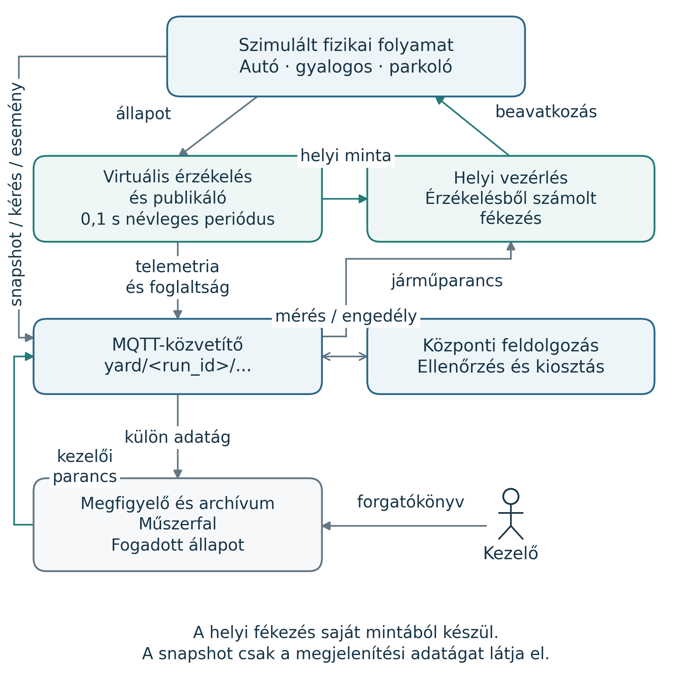

# Ábramelléklet: helyi vezérlés és adatfolyam

Ez a melléklet a fő jelentés rendszerleírását két kiegészítő ábrával részletezi. Az **A1. ábra** a jármű helyi mozgásvezérlésének fontos állapotait, az **A2. ábra** a folyamatmodell, a MQTT-adatút és a visszaható döntések kapcsolatát mutatja. Az ábrák a szimulált rendszerre vonatkoznak; fizikai jármű, kamera vagy egy valódi gyár biztonsági működését nem igazolják.

## A1. A helyi mozgásvezérlés állapotai

Az **A1. ábrán** a parkolóengedélyre várakozó jármű érvényes hozzárendelés után haladhat. A mozgásmodell minden integrációs lépésben újraszámítja a haladási korlátot és a célsebességet. Gyalogos vagy hiányzó zónaengedély megállási határt ad; elavult helyi érzékelés vagy jelzett kapcsolatvesztés nulla célsebességet ír elő. A sebesség a megadott fékezési korláttal változik, ezért az állapot neve nem bizonyítja, hogy a jármű már áll.

**A1. ábra – A helyi mozgásvezérlés fontos állapotai. Forrás: Saját programmal szerkesztett ábra a megvalósítás alapján.**

Az **A1. ábra** szándékosan a fő átmenetek vázlata. Az aktuális kódban a megállási okok között közvetlen váltás is történhet, a kezelői megállítás külön `frozen` állapot, a kijelölt hely lezárása pedig további várakozási eset. A normál gyalogos- és zónavárakozási állapot megjelenése a megállási határ közelségétől is függ; távolabb a jármű `driving` állapotban hordozhat várakozási okot. Helyreállás után csak akkor következik haladás, ha a további korlátok is engedik. Az absztrakt kiadás parkolási tartózkodás és visszaigazolt foglaltság után történhet; a tényleges kihajtási útvonal nincs modellezve.

Az állapotábra ellenőrzési alapja a `factory_yard/model.py` állomány `World._limits`, `World._car_step` és `World.step` működése. A diagram kiegészítő részlet, nem a teljes állapotgép formális bizonyítása.

Szerkeszthető terv: [car_states.puml](course-report/car_states.puml). Vektoros ábra: [car_states.svg](course-report/figures/car_states.svg).

## A2. A folyamat és az adatút nulladrendű áttekintése

Az **A2. ábrán** az érzékelt adatok a publikálótól a MQTT-közvetítőn át jutnak a központi feldolgozáshoz. A koordinátor kérelmeket, telemetriát, parkolóérzékelést és azonosított eseményeket fogad. A parkoló- és zónaengedély a közvetítőn keresztül tér vissza a járművezérléshez. A helyi akadályminta közvetlenül is bemenet a helyi fékezéshez; ez a döntés nem új központi megállítási válaszra vár.

**A2. ábra – A fizikai folyamat és az adatút 0. szintű áttekintése. Forrás: Saját programmal szerkesztett ábra a megvalósítás alapján.**

Az **A2. ábra** külön jelöli a megjelenítési adatágat és a kezelői parancs visszaútját. A teljes megjelenítési `snapshot` a megfigyelőhöz és az archívumhoz kerül, a koordinátor nem iratkozik fel erre a témára. A névleges 0,1 s-os periódus a referencia-konfiguráció érzékelési és telemetria-mintavételét jelöli modellidőben. A runtime megjelenítési snapshotjának közlése ettől külön, valós időhöz kötött ciklus. A diagram funkcionális adatfolyam-vázlat; a részletes MQTT-témákat és jeldefiníciókat a fő jelentés tárgyalja.

Az adatfolyam ellenőrzési alapja a `factory_yard/runtime.py` szimulátor- és koordinátorfolyamata, a `factory_yard/mqtt_bus.py` publikálási és feliratkozási kezelése, valamint a mozgásmodell mintakibocsátása. Az ábrák helyi Matplotlib-rajzolóval készültek a saját PUML-tervek alapján, nem automatikus PlantUML-rendereléssel. Újra előállíthatók az `experiments/course_diagrams.py` programmal; a forrás- és képazonosítókat a [diagrams-manifest.json](course-report/figures/diagrams-manifest.json) rögzíti.

Szerkeszthető terv: [dataflow.puml](course-report/dataflow.puml). Vektoros ábra: [dataflow.svg](course-report/figures/dataflow.svg).
